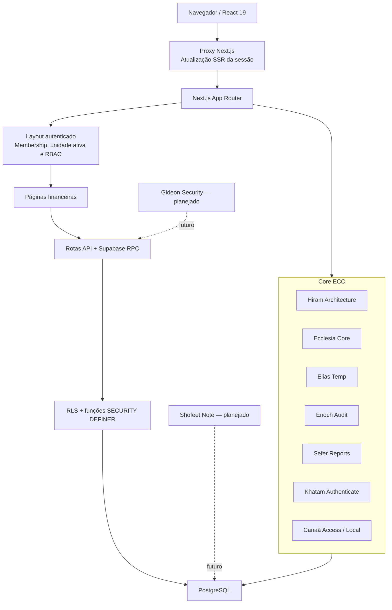

# Ecclesia Finance ECC 2.0

Ecclesia Finance ECC 2.0 é um monólito modular para gestão financeira de igrejas e organizações não governamentais. O software combina Next.js 16 (App Router), React 19, TypeScript, Tailwind CSS e Supabase/PostgreSQL.

O sistema foi modelado como um **ERP financeiro hierárquico e multi-tenant**:

- `church`: vocabulário de congregação, dízimos, ofertas, sede e pastor.
- `ong`: vocabulário de unidade/projeto, doações recorrentes/livres, matriz e diretor.
- Cada unidade possui `parent_id`, nível organizacional e memberships próprias.
- O isolamento principal é aplicado pelas políticas RLS e pelas funções RPC do PostgreSQL.

> “Implementado” neste repositório significa que existe código e migrations versionados. Não significa que o recurso foi publicado ou validado em um ambiente cloud externo.

## Índice Obsidian

- [[00 - Visao Geral ECC]]
- [[RELATORIO_TECNICO_PROJETO|Relatório técnico mestre]]
- [[Ecclesia Core]]
- [[Hiram Architecture]]
- [[Elias Temp]]
- [[Enoch Audit]]
- [[Sefer Reports]]
- [[Khatam Authenticate]]
- [[Canaa Local]]
- [[Canaa Access]]
- [[Noah Developer]]
- [[Gideon Security]]
- [[Shofeet Note]]

## Visualização técnica

- [[docs/01 - Arquitetura Viva ECC.canvas|Arquitetura Viva ECC]]
- [[docs/00 - Visao Geral ECC|Visão Geral ECC]]

## Arquitetura em resumo

## Fluxo ponta a ponta

1. O usuário acessa uma página protegida.
2. `proxy.ts` atualiza a sessão Supabase SSR e bloqueia usuários não autenticados.
3. O layout consulta memberships e a unidade ativa salva no cookie.
4. O domínio converte memberships, papéis e overrides em permissões.
5. Páginas carregam dados por RLS e componentes Managers enviam operações às APIs.
6. APIs chamam funções RPC PostgreSQL.
7. RPCs verificam papéis/permissões, período fechado e registram auditoria.
8. Ajustes e estornos criam correções formais em vez de editar o histórico original.
9. O fechamento consolida o saldo da competência e bloqueia alterações retroativas.
10. Relatórios agregam dados e geram PDF/Excel no navegador.

## Módulos implementados no código

| Módulo | Estado |
|---|---|
| [[Ecclesia Core]] | Implementado parcialmente |
| [[Hiram Architecture]] | Implementado no código |
| [[Elias Temp]] | Implementado no código |
| [[Enoch Audit]] | Implementado no código |
| [[Sefer Reports]] | Implementado no código |
| [[Khatam Authenticate]] | Licença básica implementada; UI/middleware comerciais incompletos |
| [[Canaa Local]] | Parcialmente implementado |
| [[Canaa Access]] | Parcialmente implementado |
| [[Noah Developer]] | Interface e autorização básicas |

## Roadmap explícito

| Módulo | Estado |
|---|---|
| [[Gideon Security]] | Planejado |
| [[Shofeet Note]] | Planejado/adialo no roadmap atual |

## Estrutura principal

- `web/src/app/(authenticated)`: páginas protegidas.
- `web/src/app/api`: endpoints HTTP.
- `web/src/app/actions`: server actions financeiras.
- `web/src/components`: Managers e componentes de apresentação.
- `web/src/domain`: regras de acesso, finanças e vocabulário.
- `web/src/lib`: sessão, Supabase, relatórios e administração.
- `web/src/modules`: módulos arquiteturais e plug-ins.
- `web/supabase/migrations`: migrations versionadas.
- `database-tests`: suíte SQL de domínio e segurança.

## Execução local

Consulte [[documentacao-interna/web-README|web/README.md]] e [a configuração local do Supabase](database-tests/supabase-setup.md).
