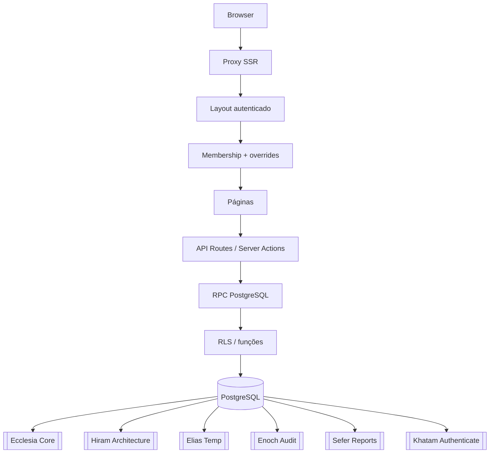

# Relatório Técnico Mestre — Ecclesia Finance ECC 2.0

| Aspecto | Estado real |
|---|---|
| Status geral | Parcialmente implementado |
| Arquitetura | Monólito Modular Next.js + Supabase |
| Páginas protegidas | Dashboard, entradas, despesas, repasses, caixa, fechamento, ajustes, estornos, auditoria, relatórios, Canaã, Admin e Noah Ops |
| Segurança | Auth SSR, memberships, RBAC/overrides e RLS PostgreSQL |
| Documentação visual | [[01 - Arquitetura Viva ECC.canvas|Canvas Vivo]] |

Este documento é o índice técnico oficial do repositório. O estado deve ser conferido contra o código e as migrations.

## Fonte única

- [[00 - Visao Geral ECC]]
- [[Ecclesia Core]]
- [[Hiram Architecture]]
- [[Elias Temp]]
- [[Enoch Audit]]
- [[Sefer Reports]]
- [[Khatam Authenticate]]
- [[Canaã Access & Local]]
- [[Noah Ops]]
- [[Gideon Security]]
- [[Shofeet Note]]

## Stack real

- Next.js 16.3.0, React 19.2.8, TypeScript 5.
- Tailwind CSS 4.
- Supabase Auth, SSR e PostgreSQL.
- React Flow.
- jsPDF e ExcelJS.
- Vercel como destino previsto.

## Por que Monólito Modular

O ECC 2.0 usa um único deploy Next.js e um único banco lógico, mas separa responsabilidades por domínio. Microsserviços seriam prematuros neste estágio: introduziriam rede, consistência distribuída, observabilidade distribuída e deploy separados sem eliminar a necessidade de transações financeiras compartilhadas.

## Passo a passo de uma operação

1. O navegador chama um Manager.
2. `proxy.ts` atualiza/verifica a sessão.
3. O layout autenticado carrega memberships e unidade ativa.
4. `can(...)` aplica papel e override.
5. API Route/Action valida autenticação e chama uma RPC.
6. O PostgreSQL valida membership, período, papel e RLS.
7. [[Elias Temp]] bloqueia competência fechada.
8. [[Enoch Audit]] registra o evento.
9. [[Sefer Reports]] agrega dados e exporta PDF/Excel.

## Multi-Tenant Hierárquico

[[Hiram Architecture]] usa `congregations.parent_id`, `organization_level`, `organization_type`, memberships e overrides. Os níveis são `national_hq`, `state_hq`, `sub_hq` e `local_congregation`. O vocabulário aplica termos reais de igreja ou ONG.

Na consolidação, o RPC recursivo soma apenas o alcance autorizado e exclui lançamentos marcados como `is_internal_transfer`, impedindo contagem duplicada de repasses internos.

## Arquitetura

## Fluxo financeiro

Autenticação SSR -> seleção da unidade ativa -> consulta de membership -> autorização por papel/override -> operação via API -> RPC PostgreSQL -> validação RLS/período -> atualização -> auditoria -> relatório.

## Migrations

Migrations 0001 a 0013 foram versionadas em `web/supabase/migrations`. A descrição detalhada é regenerada pelo comando `npm run docs:sync`.

<!-- AUTO-SYNC:START -->
## Inventário sincronizado do código

> Gerado por `npm run docs:sync`. Conteúdo entre estes marcadores não deve ser editado manualmente.

### Rotas autenticadas

- `/admin` — [web/src/app/(authenticated)/admin/page.tsx](web/src/app/(authenticated)/admin/page.tsx)
- `/ajustes` — [web/src/app/(authenticated)/ajustes/page.tsx](web/src/app/(authenticated)/ajustes/page.tsx)
- `/auditoria` — [web/src/app/(authenticated)/auditoria/page.tsx](web/src/app/(authenticated)/auditoria/page.tsx)
- `/caixa` — [web/src/app/(authenticated)/caixa/page.tsx](web/src/app/(authenticated)/caixa/page.tsx)
- `/canaa` — [web/src/app/(authenticated)/canaa/page.tsx](web/src/app/(authenticated)/canaa/page.tsx)
- `/configuracoes` — [web/src/app/(authenticated)/configuracoes/page.tsx](web/src/app/(authenticated)/configuracoes/page.tsx)
- `/despesas` — [web/src/app/(authenticated)/despesas/page.tsx](web/src/app/(authenticated)/despesas/page.tsx)
- `/entradas` — [web/src/app/(authenticated)/entradas/page.tsx](web/src/app/(authenticated)/entradas/page.tsx)
- `/estornos` — [web/src/app/(authenticated)/estornos/page.tsx](web/src/app/(authenticated)/estornos/page.tsx)
- `/fechamento` — [web/src/app/(authenticated)/fechamento/page.tsx](web/src/app/(authenticated)/fechamento/page.tsx)
- `/noah-ops` — [web/src/app/(authenticated)/noah-ops/page.tsx](web/src/app/(authenticated)/noah-ops/page.tsx)
- `/` — [web/src/app/(authenticated)/page.tsx](web/src/app/(authenticated)/page.tsx)
- `/relatorios` — [web/src/app/(authenticated)/relatorios/page.tsx](web/src/app/(authenticated)/relatorios/page.tsx)
- `/repasses` — [web/src/app/(authenticated)/repasses/page.tsx](web/src/app/(authenticated)/repasses/page.tsx)

### APIs

- [web/src/app/api/adjustments/route.ts](web/src/app/api/adjustments/route.ts)
- [web/src/app/api/admin/congregations/[id]/route.ts](web/src/app/api/admin/congregations/[id]/route.ts)
- [web/src/app/api/admin/congregations/route.ts](web/src/app/api/admin/congregations/route.ts)
- [web/src/app/api/admin/overview/route.ts](web/src/app/api/admin/overview/route.ts)
- [web/src/app/api/admin/users/[userId]/access/route.ts](web/src/app/api/admin/users/[userId]/access/route.ts)
- [web/src/app/api/admin/users/route.ts](web/src/app/api/admin/users/route.ts)
- [web/src/app/api/cash/movements/route.ts](web/src/app/api/cash/movements/route.ts)
- [web/src/app/api/cash/periods/route.ts](web/src/app/api/cash/periods/route.ts)
- [web/src/app/api/cash/registers/route.ts](web/src/app/api/cash/registers/route.ts)
- [web/src/app/api/closing/route.ts](web/src/app/api/closing/route.ts)
- [web/src/app/api/entries/route.ts](web/src/app/api/entries/route.ts)
- [web/src/app/api/expenses/approve/route.ts](web/src/app/api/expenses/approve/route.ts)
- [web/src/app/api/expenses/route.ts](web/src/app/api/expenses/route.ts)
- [web/src/app/api/financial/hierarchical-metrics/route.ts](web/src/app/api/financial/hierarchical-metrics/route.ts)
- [web/src/app/api/health/route.ts](web/src/app/api/health/route.ts)
- [web/src/app/api/reports/route.ts](web/src/app/api/reports/route.ts)
- [web/src/app/api/reversals/route.ts](web/src/app/api/reversals/route.ts)
- [web/src/app/api/transfers/approve/route.ts](web/src/app/api/transfers/approve/route.ts)
- [web/src/app/api/transfers/confirm/route.ts](web/src/app/api/transfers/confirm/route.ts)
- [web/src/app/api/transfers/route.ts](web/src/app/api/transfers/route.ts)

### Migrations

- [web/supabase/migrations/0001_finance_core.sql](web/supabase/migrations/0001_finance_core.sql)
- [web/supabase/migrations/0002_integrity_and_documents.sql](web/supabase/migrations/0002_integrity_and_documents.sql)
- [web/supabase/migrations/0003_financial_cycle_commands.sql](web/supabase/migrations/0003_financial_cycle_commands.sql)
- [web/supabase/migrations/0004_domain_completion.sql](web/supabase/migrations/0004_domain_completion.sql)
- [web/supabase/migrations/0005_domain_completion_fix.sql](web/supabase/migrations/0005_domain_completion_fix.sql)
- [web/supabase/migrations/0006_cash_movement_idempotency_fix.sql](web/supabase/migrations/0006_cash_movement_idempotency_fix.sql)
- [web/supabase/migrations/0007_performance_indexes.sql](web/supabase/migrations/0007_performance_indexes.sql)
- [web/supabase/migrations/0008_organization_admin_permissions.sql](web/supabase/migrations/0008_organization_admin_permissions.sql)
- [web/supabase/migrations/0009_hierarchical_scope_permissions.sql](web/supabase/migrations/0009_hierarchical_scope_permissions.sql)
- [web/supabase/migrations/0010_congregation_leader_name.sql](web/supabase/migrations/0010_congregation_leader_name.sql)
- [web/supabase/migrations/0011_admin_create_congregation_parent.sql](web/supabase/migrations/0011_admin_create_congregation_parent.sql)
- [web/supabase/migrations/0012_hierarchical_financial_architecture.sql](web/supabase/migrations/0012_hierarchical_financial_architecture.sql)
- [web/supabase/migrations/0013_khatam_licenses.sql](web/supabase/migrations/0013_khatam_licenses.sql)

### Código dos módulos

- [web/src/modules/core/canaa/README.md](web/src/modules/core/canaa/README.md)
- [web/src/modules/core/canaa/actions/canaa.actions.ts](web/src/modules/core/canaa/actions/canaa.actions.ts)
- [web/src/modules/core/canaa/components/CongregationFlowMap.tsx](web/src/modules/core/canaa/components/CongregationFlowMap.tsx)
- [web/src/modules/core/canaa/components/CongregationNode.tsx](web/src/modules/core/canaa/components/CongregationNode.tsx)
- [web/src/modules/core/canaa/components/InviteOperatorModal.tsx](web/src/modules/core/canaa/components/InviteOperatorModal.tsx)
- [web/src/modules/core/canaa/components/LocalTeamManager.tsx](web/src/modules/core/canaa/components/LocalTeamManager.tsx)
- [web/src/modules/core/canaa/components/ModuleArchitectureMap.tsx](web/src/modules/core/canaa/components/ModuleArchitectureMap.tsx)
- [web/src/modules/core/canaa/components/NoahTelemetryGrid.tsx](web/src/modules/core/canaa/components/NoahTelemetryGrid.tsx)
- [web/src/modules/core/canaa/types.ts](web/src/modules/core/canaa/types.ts)
- [web/src/modules/core/elias/README.md](web/src/modules/core/elias/README.md)
- [web/src/modules/core/enoch/README.md](web/src/modules/core/enoch/README.md)
- [web/src/modules/core/hiram/README.md](web/src/modules/core/hiram/README.md)
- [web/src/modules/core/khatam/README.md](web/src/modules/core/khatam/README.md)
- [web/src/modules/core/khatam/components/KhatamQuotaBar.tsx](web/src/modules/core/khatam/components/KhatamQuotaBar.tsx)
- [web/src/modules/core/khatam/services/license.service.ts](web/src/modules/core/khatam/services/license.service.ts)
- [web/src/modules/core/khatam/services/license.shared.ts](web/src/modules/core/khatam/services/license.shared.ts)
- [web/src/modules/core/sefer/README.md](web/src/modules/core/sefer/README.md)
- [web/src/modules/plugins/gideon/README.md](web/src/modules/plugins/gideon/README.md)
- [web/src/modules/plugins/shofeet/README.md](web/src/modules/plugins/shofeet/README.md)

### Editor do grafo e console Noah

- [web/src/modules/core/canaa/components/CongregationFlowMap.tsx](web/src/modules/core/canaa/components/CongregationFlowMap.tsx) — conexão React Flow habilitada; layout Dagre.
- [web/src/app/(authenticated)/noah-ops/page.tsx](web/src/app/(authenticated)/noah-ops/page.tsx) — inclui mapa de arquitetura ECC.
- [02 - Telemetria & Contas Ao Vivo.md](docs/02 - Telemetria & Contas Ao Vivo.md) — snapshot Supabase; atualização periódica disponível com `npm run docs:watch`.

<!-- AUTO-SYNC:END -->
