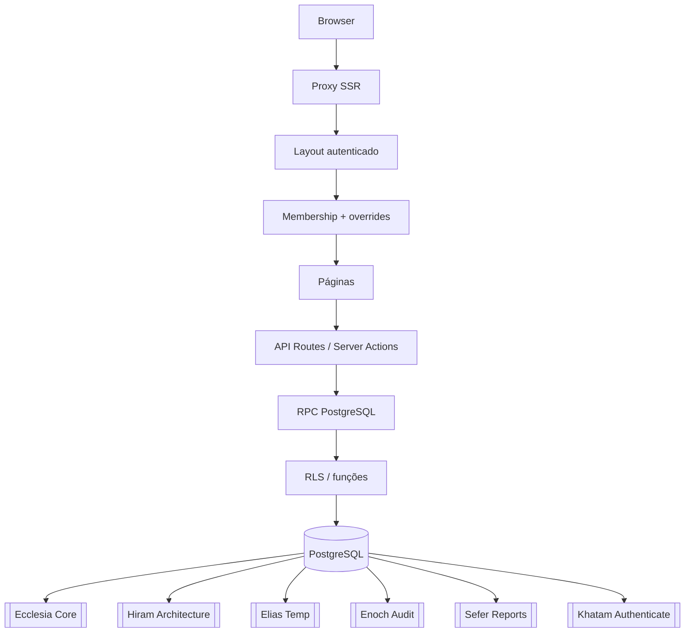

# Relatório Técnico Mestre — Ecclesia Finance ECC 2.0

| Aspecto | Estado real |
|---|---|
| Status geral | Parcialmente implementado |
| Arquitetura | Monólito Modular Next.js + Supabase |
| Páginas protegidas | Dashboard, entradas, despesas, repasses, caixa, fechamento, ajustes, estornos, auditoria, relatórios, Canaã, Admin e Noah Ops |
| Segurança | Auth SSR, memberships, RBAC/overrides e RLS PostgreSQL |

Este documento é o índice técnico oficial do repositório. O estado deve ser conferido contra o código e as migrations.

## Documentação

- [Visão geral do sistema](docs/00%20-%20Visao%20Geral%20ECC.md)
- [Índice dos módulos](docs/modulos/README.md)

## Stack real

- Next.js 16.3.0, React 19.2.8, TypeScript 5.
- Tailwind CSS 4.
- Supabase Auth, SSR e PostgreSQL.
- React Flow.
- jsPDF e ExcelJS.
- Vercel como destino previsto.

## Por que Monólito Modular

O ECC 2.0 usa um único deploy Next.js e um único banco lógico, mas separa responsabilidades por domínio. Microsserviços seriam prematuros neste estágio: introduziriam rede, consistência distribuída, observabilidade distribuída e deploy separados sem eliminar a necessidade de transações financeiras compartilhadas.

## Passo a passo de uma operação

1. O navegador chama um Manager.
2. `proxy.ts` atualiza/verifica a sessão.
3. O layout autenticado carrega memberships e unidade ativa.
4. `can(...)` aplica papel e override.
5. API Route/Action valida autenticação e chama uma RPC.
6. O PostgreSQL valida membership, período, papel e RLS.
7. [Elias Temp](docs/modulos/Elias%20Temp.md) bloqueia competência fechada.
8. [Enoch Audit](docs/modulos/Enoch%20Audit.md) registra o evento.
9. [Sefer Reports](docs/modulos/Sefer%20Reports.md) agrega dados e exporta PDF/Excel.

## Multi-Tenant Hierárquico

[Hiram Architecture](docs/modulos/Hiram%20Architecture.md) usa `congregations.parent_id`, `organization_level`, `organization_type`, memberships e overrides. Os níveis são `national_hq`, `state_hq`, `sub_hq` e `local_congregation`. O vocabulário aplica termos reais de igreja ou ONG.

Na consolidação, o RPC recursivo soma apenas o alcance autorizado e exclui lançamentos marcados como `is_internal_transfer`, impedindo contagem duplicada de repasses internos.

## Arquitetura

## Fluxo financeiro

Autenticação SSR -> seleção da unidade ativa -> consulta de membership -> autorização por papel/override -> operação via API -> RPC PostgreSQL -> validação RLS/período -> atualização -> auditoria -> relatório.

## Migrations

Migrations 0001 a 0013 estão versionadas em `web/supabase/migrations`.
