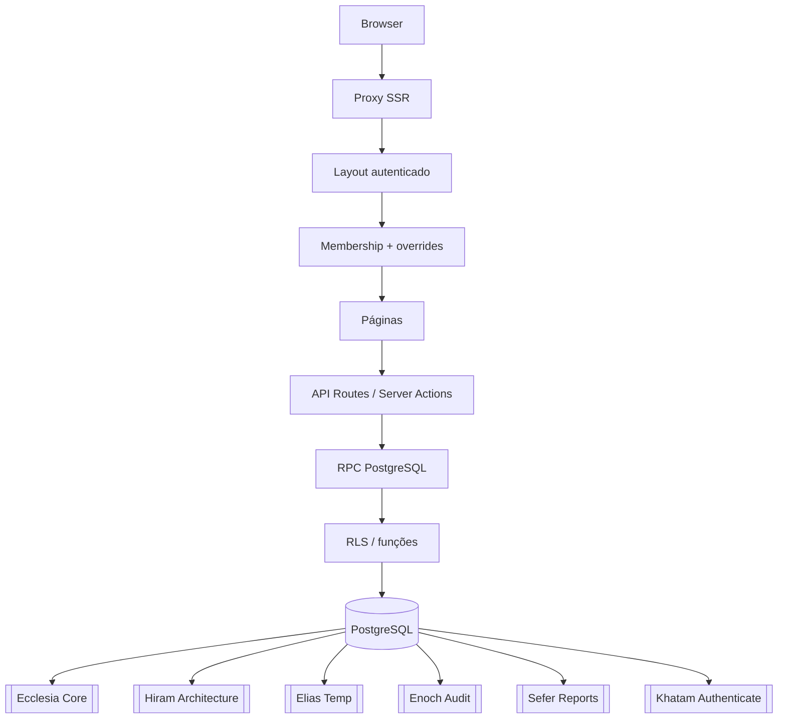

# Relatório Técnico Mestre — Ecclesia Finance ECC 2.0

Este documento é o índice técnico oficial do repositório. O estado deve ser conferido contra o código e as migrations.

## Fonte única

- [[00 - Visao Geral ECC]]
- [[Ecclesia Core]]
- [[Hiram Architecture]]
- [[Elias Temp]]
- [[Enoch Audit]]
- [[Sefer Reports]]
- [[Khatam Authenticate]]
- [[Canaa Local]]
- [[Canaa Access]]
- [[Noah Developer]]
- [[Gideon Security]]
- [[Shofeet Note]]

## Stack real

- Next.js 16.3.0, React 19.2.8, TypeScript 5.
- Tailwind CSS 4.
- Supabase Auth, SSR e PostgreSQL.
- React Flow.
- jsPDF e ExcelJS.
- Vercel como destino previsto.

## Arquitetura

## Fluxo financeiro

Autenticação SSR -> seleção da unidade ativa -> consulta de membership -> autorização por papel/override -> operação via API -> RPC PostgreSQL -> validação RLS/período -> atualização -> auditoria -> relatório.

## Migrations

Migrations 0001 a 0013 foram versionadas em `web/supabase/migrations`. A descrição detalhada é regenerada pelo comando `npm run docs:sync`.

<!-- AUTO-SYNC:START -->
## Estrutura sincronizada automaticamente

> Gerado por `npm run docs:sync`. Não edite manualmente o conteúdo entre os marcadores.

### Rotas protegidas

- [web/src/app/(authenticated)/admin/page.tsx](web/src/app/(authenticated)/admin/page.tsx)
- [web/src/app/(authenticated)/ajustes/page.tsx](web/src/app/(authenticated)/ajustes/page.tsx)
- [web/src/app/(authenticated)/auditoria/page.tsx](web/src/app/(authenticated)/auditoria/page.tsx)
- [web/src/app/(authenticated)/caixa/page.tsx](web/src/app/(authenticated)/caixa/page.tsx)
- [web/src/app/(authenticated)/canaa/page.tsx](web/src/app/(authenticated)/canaa/page.tsx)
- [web/src/app/(authenticated)/configuracoes/page.tsx](web/src/app/(authenticated)/configuracoes/page.tsx)
- [web/src/app/(authenticated)/despesas/page.tsx](web/src/app/(authenticated)/despesas/page.tsx)
- [web/src/app/(authenticated)/entradas/page.tsx](web/src/app/(authenticated)/entradas/page.tsx)
- [web/src/app/(authenticated)/estornos/page.tsx](web/src/app/(authenticated)/estornos/page.tsx)
- [web/src/app/(authenticated)/fechamento/page.tsx](web/src/app/(authenticated)/fechamento/page.tsx)
- [web/src/app/(authenticated)/noah-ops/page.tsx](web/src/app/(authenticated)/noah-ops/page.tsx)
- [web/src/app/(authenticated)/page.tsx](web/src/app/(authenticated)/page.tsx)
- [web/src/app/(authenticated)/relatorios/page.tsx](web/src/app/(authenticated)/relatorios/page.tsx)
- [web/src/app/(authenticated)/repasses/page.tsx](web/src/app/(authenticated)/repasses/page.tsx)

### Migrations

- `web/supabase/migrations/0001_finance_core.sql`
- `web/supabase/migrations/0002_integrity_and_documents.sql`
- `web/supabase/migrations/0003_financial_cycle_commands.sql`
- `web/supabase/migrations/0004_domain_completion.sql`
- `web/supabase/migrations/0005_domain_completion_fix.sql`
- `web/supabase/migrations/0006_cash_movement_idempotency_fix.sql`
- `web/supabase/migrations/0007_performance_indexes.sql`
- `web/supabase/migrations/0008_organization_admin_permissions.sql`
- `web/supabase/migrations/0009_hierarchical_scope_permissions.sql`
- `web/supabase/migrations/0010_congregation_leader_name.sql`
- `web/supabase/migrations/0011_admin_create_congregation_parent.sql`
- `web/supabase/migrations/0012_hierarchical_financial_architecture.sql`
- `web/supabase/migrations/0013_khatam_licenses.sql`

### Módulos

- [web/src/modules/core/canaa/README.md](web/src/modules/core/canaa/README.md)
- [web/src/modules/core/elias/README.md](web/src/modules/core/elias/README.md)
- [web/src/modules/core/enoch/README.md](web/src/modules/core/enoch/README.md)
- [web/src/modules/core/hiram/README.md](web/src/modules/core/hiram/README.md)
- [web/src/modules/core/khatam/README.md](web/src/modules/core/khatam/README.md)
- [web/src/modules/core/sefer/README.md](web/src/modules/core/sefer/README.md)
- [web/src/modules/plugins/gideon/README.md](web/src/modules/plugins/gideon/README.md)
- [web/src/modules/plugins/shofeet/README.md](web/src/modules/plugins/shofeet/README.md)

<!-- AUTO-SYNC:END -->
