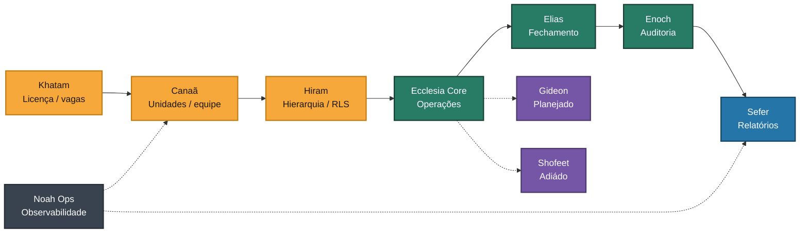
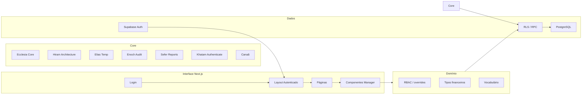
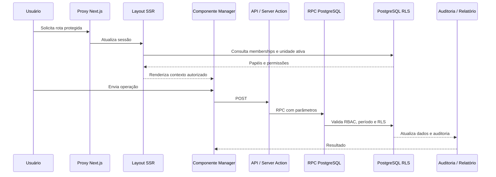
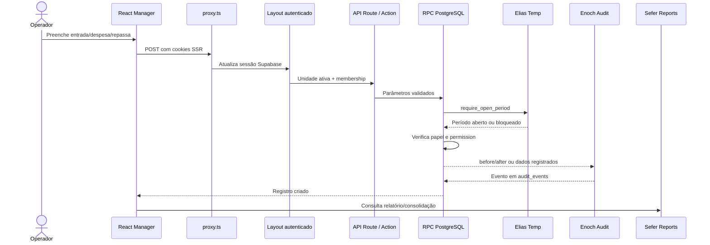

# Visão Geral — Ecclesia Finance ECC 2.0

| Aspecto | Estado real |
|---|---|
| Status geral | **Parcialmente implementado** |
| Camada | Core financeiro, arquitetural e módulos planejados |
| Arquitetura | Monólito Modular Next.js + Supabase |
| Banco | PostgreSQL, RLS e RPCs |
| Rotas principais | `/`, `/entradas`, `/despesas`, `/repasses`, `/caixa`, `/fechamento`, `/ajustes`, `/estornos`, `/auditoria`, `/relatorios`, `/canaa`, `/admin`, `/noah-ops` |

> Abrir o mapa visual: [[01 - Arquitetura Viva ECC.canvas|Arquitetura Viva ECC]]

Índice do vault: [[modulos/README|Módulos ECC]]

## Identidade do produto

O ECC 2.0 é um ERP financeiro multi-tenant e hierárquico voltado à gestão financeira de **igrejas** e **ONGs/associações**. A aplicação usa Next.js 16 App Router, React 19, TypeScript, Tailwind CSS e Supabase/PostgreSQL.

A configuração organizacional aceita `church` ou `ong` e altera os termos apresentados pela tela. A implementação está em [[Hiram Architecture]] e [vocabulary.ts](../web/src/domain/vocabulary.ts).

## Monólito Modular

O ECC 2.0 é um **monólito modular**: uma única aplicação Next.js é implantada e compartilha autenticação, sessão, componentes, build e banco; internamente, o domínio é separado em módulos reconhecíveis. Essa escolha reduz latência entre operações, evita a coordenação distribuída entre microsserviços e simplifica transações PostgreSQL/RLS neste estágio do produto.

A separação não é apenas visual: cada módulo possui responsabilidade, identidade, documentos e, quando aplicável, migrations/RPCs próprias. [[Gideon Security]] e [[Shofeet Note]] foram isolados como plug-ins futuros para que regras fiscais ou de segurança externa não contaminem o núcleo financeiro.

## Componentes reais

| Camada | Conteúdo real |
|---|---|
| Presentação | `src/app`, `src/components` |
| Domínio | `src/domain/access.ts`, `finance.ts`, `vocabulary.ts`, `audit.ts` |
| Aplicação | Server Components, Server Actions e API Routes |
| Integração | `src/lib/supabase`, `src/lib/admin`, `src/lib/reports` |
| Banco | migrations 0001 a 0013 |

## Fluxo de dados

## Como uma operação financeira funciona por dentro

1. **Navegador:** um componente `*Manager` converte valores monetários para centavos e envia JSON.
2. **Sessão:** `proxy.ts` usa `updateSession()` para recuperar/refrescar o usuário Supabase SSR.
3. **Contexto:** o layout consulta memberships e lê `active_congregation_id` do cookie.
4. **RBAC:** `can(...)` aplica papel padrão ou override de `membership_permission_overrides`.
5. **Transporte:** API Route ou Server Action autentica novamente e chama uma RPC.
6. **PostgreSQL:** a RPC valida rol, período aberto e relacionamentos; o RLS continua como última barreira.
7. **Fechamento:** `period_is_closed` e `require_open_period` bloqueiam alterações retroativas.
8. **Auditoria:** operações críticas inserem before/after e identificam `actor_id`.
9. **Consolidação:** `congregation_monthly_summary` calcula o saldo da competência e o relatório coleta os dados.

## Multi-Tenant Hierárquico Hiram

`congregations` usa `parent_id` para representar a hierarquia. `organization_level` aceita `national_hq`, `state_hq`, `sub_hq` e `local_congregation`. As migrations também restringem pais compatíveis e já adicionaram controle de ciclos no editor visual.

O `organization_type` aceita `church` ou `ong`. `getVocabulary()` troca Congregação/Congregações, Sede/Matriz, Pastoral/Diretoria e demais termos sem duplicar regras financeiras.

No modo consolidado, `get_hierarchical_financial_metrics` percorre recursivamente a árvore com CTE. Entradas e despesas marcadas com `is_internal_transfer = true` são excluídas da soma consolidada. Isso evita que dinheiro transferido internamente seja contado duas vezes como receita nova e despesa nova em níveis superiores.

## Autenticação e contexto

- `src/proxy.ts` protege todas as rotas correspondentes ao matcher.
- `/login` e `/api/health` são públicos.
- `src/lib/supabase/middleware.ts` cria o cliente SSR e recupera o usuário.
- `src/app/(authenticated)/layout.tsx` obtém memberships e define a unidade ativa pelo cookie `active_congregation_id`.
- `CongregationSwitcher` permite trocar a unidade ativa.
- O Dev Master é identificado por metadata ou pelo e-mail temporariamente definido como fallback em `isMasterAdmin`.

## Estados reais da implementação

### Implementado no código

- Login e sessão.
- Unidade ativa e troca de unidade.
- Dashboard mensal e hierarquia financeira.
- Entradas, despesas, repasses, caixa, fechamento, ajustes e estornos.
- Auditoria por unidade.
- Relatórios PDF e Excel.
- Administração global de unidades e acessos.
- RLS, RBAC, overrides, idempotência e migrations.
- Licenças básicas Khatam.

### Parcialmente implementado

- Cadastro completo da equipe Canaã.
- Telemetria real Noah Ops.
- Reabertura formal e fluxo de caixa físico na interface.
- Modelo administrativo global depende de `SUPABASE_SERVICE_ROLE_KEY`.
- O convite Canaã depende de licença e configuração server-side.

### Planejado / adiado

- [[Gideon Security]]: Pix mTLS/DICT, defesa de borda, nonce e WORM.
- [[Shofeet Note]]: NF-e/NFC-e/NFS-e, XML, certificado A1 e ITG 2002/SPED.

## Mapa de documentação

- [[Ecclesia Core]]
- [[Hiram Architecture]]
- [[Elias Temp]]
- [[Enoch Audit]]
- [[Sefer Reports]]
- [[Khatam Authenticate]]
- [[Canaã Access & Local]]
- [[Noah Ops]]
- [[Gideon Security]]
- [[Shofeet Note]]

<!-- AUTO-SYNC:START -->
## Inventário sincronizado do código

> Gerado por `npm run docs:sync`. Conteúdo entre estes marcadores não deve ser editado manualmente.

### Rotas autenticadas

- `/admin` — [web/src/app/(authenticated)/admin/page.tsx](../web/src/app/(authenticated)/admin/page.tsx)
- `/ajustes` — [web/src/app/(authenticated)/ajustes/page.tsx](../web/src/app/(authenticated)/ajustes/page.tsx)
- `/auditoria` — [web/src/app/(authenticated)/auditoria/page.tsx](../web/src/app/(authenticated)/auditoria/page.tsx)
- `/caixa` — [web/src/app/(authenticated)/caixa/page.tsx](../web/src/app/(authenticated)/caixa/page.tsx)
- `/canaa` — [web/src/app/(authenticated)/canaa/page.tsx](../web/src/app/(authenticated)/canaa/page.tsx)
- `/configuracoes` — [web/src/app/(authenticated)/configuracoes/page.tsx](../web/src/app/(authenticated)/configuracoes/page.tsx)
- `/despesas` — [web/src/app/(authenticated)/despesas/page.tsx](../web/src/app/(authenticated)/despesas/page.tsx)
- `/entradas` — [web/src/app/(authenticated)/entradas/page.tsx](../web/src/app/(authenticated)/entradas/page.tsx)
- `/estornos` — [web/src/app/(authenticated)/estornos/page.tsx](../web/src/app/(authenticated)/estornos/page.tsx)
- `/fechamento` — [web/src/app/(authenticated)/fechamento/page.tsx](../web/src/app/(authenticated)/fechamento/page.tsx)
- `/noah-ops` — [web/src/app/(authenticated)/noah-ops/page.tsx](../web/src/app/(authenticated)/noah-ops/page.tsx)
- `/` — [web/src/app/(authenticated)/page.tsx](../web/src/app/(authenticated)/page.tsx)
- `/relatorios` — [web/src/app/(authenticated)/relatorios/page.tsx](../web/src/app/(authenticated)/relatorios/page.tsx)
- `/repasses` — [web/src/app/(authenticated)/repasses/page.tsx](../web/src/app/(authenticated)/repasses/page.tsx)

### APIs

- [web/src/app/api/adjustments/route.ts](../web/src/app/api/adjustments/route.ts)
- [web/src/app/api/admin/congregations/[id]/route.ts](../web/src/app/api/admin/congregations/[id]/route.ts)
- [web/src/app/api/admin/congregations/route.ts](../web/src/app/api/admin/congregations/route.ts)
- [web/src/app/api/admin/overview/route.ts](../web/src/app/api/admin/overview/route.ts)
- [web/src/app/api/admin/users/[userId]/access/route.ts](../web/src/app/api/admin/users/[userId]/access/route.ts)
- [web/src/app/api/admin/users/route.ts](../web/src/app/api/admin/users/route.ts)
- [web/src/app/api/cash/movements/route.ts](../web/src/app/api/cash/movements/route.ts)
- [web/src/app/api/cash/periods/route.ts](../web/src/app/api/cash/periods/route.ts)
- [web/src/app/api/cash/registers/route.ts](../web/src/app/api/cash/registers/route.ts)
- [web/src/app/api/closing/route.ts](../web/src/app/api/closing/route.ts)
- [web/src/app/api/entries/route.ts](../web/src/app/api/entries/route.ts)
- [web/src/app/api/expenses/approve/route.ts](../web/src/app/api/expenses/approve/route.ts)
- [web/src/app/api/expenses/route.ts](../web/src/app/api/expenses/route.ts)
- [web/src/app/api/financial/hierarchical-metrics/route.ts](../web/src/app/api/financial/hierarchical-metrics/route.ts)
- [web/src/app/api/health/route.ts](../web/src/app/api/health/route.ts)
- [web/src/app/api/reports/route.ts](../web/src/app/api/reports/route.ts)
- [web/src/app/api/reversals/route.ts](../web/src/app/api/reversals/route.ts)
- [web/src/app/api/transfers/approve/route.ts](../web/src/app/api/transfers/approve/route.ts)
- [web/src/app/api/transfers/confirm/route.ts](../web/src/app/api/transfers/confirm/route.ts)
- [web/src/app/api/transfers/route.ts](../web/src/app/api/transfers/route.ts)

### Migrations

- [web/supabase/migrations/0001_finance_core.sql](../web/supabase/migrations/0001_finance_core.sql)
- [web/supabase/migrations/0002_integrity_and_documents.sql](../web/supabase/migrations/0002_integrity_and_documents.sql)
- [web/supabase/migrations/0003_financial_cycle_commands.sql](../web/supabase/migrations/0003_financial_cycle_commands.sql)
- [web/supabase/migrations/0004_domain_completion.sql](../web/supabase/migrations/0004_domain_completion.sql)
- [web/supabase/migrations/0005_domain_completion_fix.sql](../web/supabase/migrations/0005_domain_completion_fix.sql)
- [web/supabase/migrations/0006_cash_movement_idempotency_fix.sql](../web/supabase/migrations/0006_cash_movement_idempotency_fix.sql)
- [web/supabase/migrations/0007_performance_indexes.sql](../web/supabase/migrations/0007_performance_indexes.sql)
- [web/supabase/migrations/0008_organization_admin_permissions.sql](../web/supabase/migrations/0008_organization_admin_permissions.sql)
- [web/supabase/migrations/0009_hierarchical_scope_permissions.sql](../web/supabase/migrations/0009_hierarchical_scope_permissions.sql)
- [web/supabase/migrations/0010_congregation_leader_name.sql](../web/supabase/migrations/0010_congregation_leader_name.sql)
- [web/supabase/migrations/0011_admin_create_congregation_parent.sql](../web/supabase/migrations/0011_admin_create_congregation_parent.sql)
- [web/supabase/migrations/0012_hierarchical_financial_architecture.sql](../web/supabase/migrations/0012_hierarchical_financial_architecture.sql)
- [web/supabase/migrations/0013_khatam_licenses.sql](../web/supabase/migrations/0013_khatam_licenses.sql)

### Código dos módulos

- [web/src/modules/core/canaa/README.md](../web/src/modules/core/canaa/README.md)
- [web/src/modules/core/canaa/actions/canaa.actions.ts](../web/src/modules/core/canaa/actions/canaa.actions.ts)
- [web/src/modules/core/canaa/components/CongregationFlowMap.tsx](../web/src/modules/core/canaa/components/CongregationFlowMap.tsx)
- [web/src/modules/core/canaa/components/CongregationNode.tsx](../web/src/modules/core/canaa/components/CongregationNode.tsx)
- [web/src/modules/core/canaa/components/InviteOperatorModal.tsx](../web/src/modules/core/canaa/components/InviteOperatorModal.tsx)
- [web/src/modules/core/canaa/components/LocalTeamManager.tsx](../web/src/modules/core/canaa/components/LocalTeamManager.tsx)
- [web/src/modules/core/canaa/components/ModuleArchitectureMap.tsx](../web/src/modules/core/canaa/components/ModuleArchitectureMap.tsx)
- [web/src/modules/core/canaa/components/NoahTelemetryGrid.tsx](../web/src/modules/core/canaa/components/NoahTelemetryGrid.tsx)
- [web/src/modules/core/canaa/types.ts](../web/src/modules/core/canaa/types.ts)
- [web/src/modules/core/elias/README.md](../web/src/modules/core/elias/README.md)
- [web/src/modules/core/enoch/README.md](../web/src/modules/core/enoch/README.md)
- [web/src/modules/core/hiram/README.md](../web/src/modules/core/hiram/README.md)
- [web/src/modules/core/khatam/README.md](../web/src/modules/core/khatam/README.md)
- [web/src/modules/core/khatam/components/KhatamQuotaBar.tsx](../web/src/modules/core/khatam/components/KhatamQuotaBar.tsx)
- [web/src/modules/core/khatam/services/license.service.ts](../web/src/modules/core/khatam/services/license.service.ts)
- [web/src/modules/core/khatam/services/license.shared.ts](../web/src/modules/core/khatam/services/license.shared.ts)
- [web/src/modules/core/sefer/README.md](../web/src/modules/core/sefer/README.md)
- [web/src/modules/plugins/gideon/README.md](../web/src/modules/plugins/gideon/README.md)
- [web/src/modules/plugins/shofeet/README.md](../web/src/modules/plugins/shofeet/README.md)

### Editor do grafo e console Noah

- [web/src/modules/core/canaa/components/CongregationFlowMap.tsx](../web/src/modules/core/canaa/components/CongregationFlowMap.tsx) — conexão React Flow habilitada; layout Dagre.
- [web/src/app/(authenticated)/noah-ops/page.tsx](../web/src/app/(authenticated)/noah-ops/page.tsx) — inclui mapa de arquitetura ECC.

<!-- AUTO-SYNC:END -->
