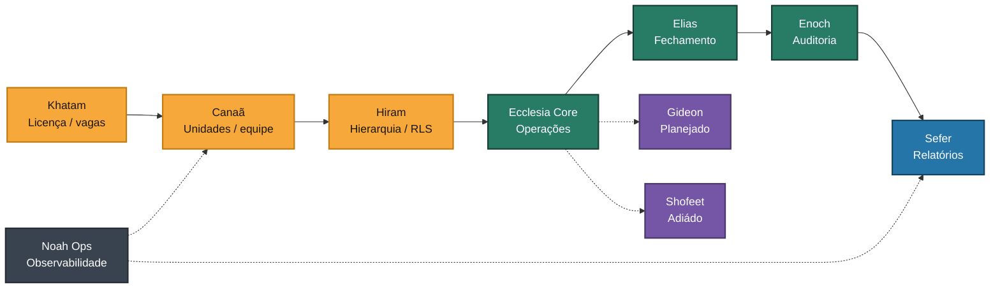
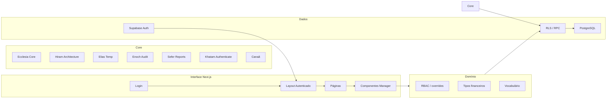
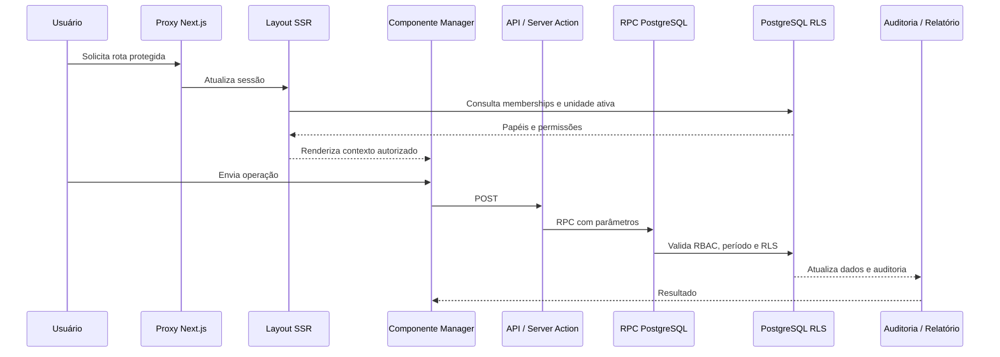
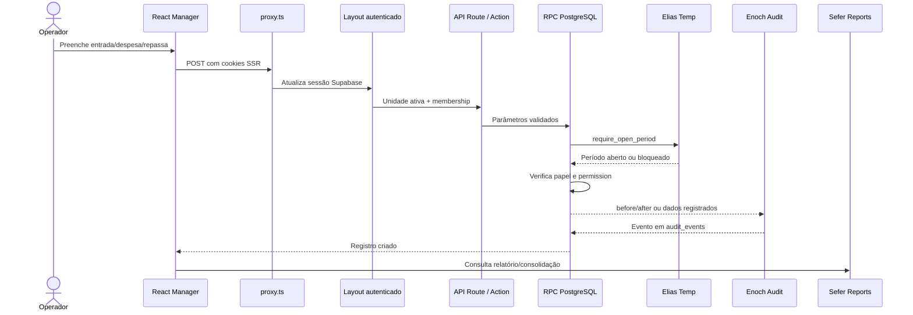

# Visão Geral — Ecclesia Finance ECC 2.0

ERP financeiro modular para igrejas e ONGs, com hierarquia organizacional, controle de acesso e auditoria.

- [Índice dos módulos](modulos/README.md)
- [Relatório técnico mestre](../RELATORIO_TECNICO_PROJETO.md)

## Identidade do produto

O ECC 2.0 é um ERP financeiro multi-tenant e hierárquico voltado à gestão financeira de **igrejas** e **ONGs/associações**. A aplicação usa Next.js 16 App Router, React 19, TypeScript, Tailwind CSS e Supabase/PostgreSQL.

A configuração organizacional aceita `church` ou `ong` e altera os termos apresentados pela tela. A implementação está em [Hiram Architecture](modulos/Hiram%20Architecture.md) e [vocabulary.ts](../web/src/domain/vocabulary.ts).

## Monólito Modular

O ECC 2.0 é um **monólito modular**: uma única aplicação Next.js é implantada e compartilha autenticação, sessão, componentes, build e banco; internamente, o domínio é separado em módulos reconhecíveis. Essa escolha reduz latência entre operações, evita a coordenação distribuída entre microsserviços e simplifica transações PostgreSQL/RLS neste estágio do produto.

A separação não é apenas visual: cada módulo possui responsabilidade, identidade, documentos e, quando aplicável, migrations/RPCs próprias. [Gideon Security](modulos/Gideon%20Security.md) e [Shofeet Note](modulos/Shofeet%20Note.md) foram isolados como plug-ins futuros para que regras fiscais ou de segurança externa não contaminem o núcleo financeiro.

## Componentes reais

| Camada | Conteúdo real |
|---|---|
| Presentação | `src/app`, `src/components` |
| Domínio | `src/domain/access.ts`, `finance.ts`, `vocabulary.ts`, `audit.ts` |
| Aplicação | Server Components, Server Actions e API Routes |
| Integração | `src/lib/supabase`, `src/lib/admin`, `src/lib/reports` |
| Banco | migrations 0001 a 0013 |

## Fluxo de dados

## Como uma operação financeira funciona por dentro

1. **Navegador:** um componente `*Manager` converte valores monetários para centavos e envia JSON.
2. **Sessão:** `proxy.ts` usa `updateSession()` para recuperar/refrescar o usuário Supabase SSR.
3. **Contexto:** o layout consulta memberships e lê `active_congregation_id` do cookie.
4. **RBAC:** `can(...)` aplica papel padrão ou override de `membership_permission_overrides`.
5. **Transporte:** API Route ou Server Action autentica novamente e chama uma RPC.
6. **PostgreSQL:** a RPC valida rol, período aberto e relacionamentos; o RLS continua como última barreira.
7. **Fechamento:** `period_is_closed` e `require_open_period` bloqueiam alterações retroativas.
8. **Auditoria:** operações críticas inserem before/after e identificam `actor_id`.
9. **Consolidação:** `congregation_monthly_summary` calcula o saldo da competência e o relatório coleta os dados.

## Multi-Tenant Hierárquico Hiram

`congregations` usa `parent_id` para representar a hierarquia. `organization_level` aceita `national_hq`, `state_hq`, `sub_hq` e `local_congregation`. As migrations também restringem pais compatíveis e já adicionaram controle de ciclos no editor visual.

O `organization_type` aceita `church` ou `ong`. `getVocabulary()` troca Congregação/Congregações, Sede/Matriz, Pastoral/Diretoria e demais termos sem duplicar regras financeiras.

No modo consolidado, `get_hierarchical_financial_metrics` percorre recursivamente a árvore com CTE. Entradas e despesas marcadas com `is_internal_transfer = true` são excluídas da soma consolidada. Isso evita que dinheiro transferido internamente seja contado duas vezes como receita nova e despesa nova em níveis superiores.

## Autenticação e contexto

- `src/proxy.ts` protege todas as rotas correspondentes ao matcher.
- `/login` e `/api/health` são públicos.
- `src/lib/supabase/middleware.ts` cria o cliente SSR e recupera o usuário.
- `src/app/(authenticated)/layout.tsx` obtém memberships e define a unidade ativa pelo cookie `active_congregation_id`.
- `CongregationSwitcher` permite trocar a unidade ativa.
- O Dev Master é identificado por metadata ou pelo e-mail temporariamente definido como fallback em `isMasterAdmin`.

## Estados reais da implementação

### Implementado no código

- Login e sessão.
- Unidade ativa e troca de unidade.
- Dashboard mensal e hierarquia financeira.
- Entradas, despesas, repasses, caixa, fechamento, ajustes e estornos.
- Auditoria por unidade.
- Relatórios PDF e Excel.
- Administração global de unidades e acessos.
- RLS, RBAC, overrides, idempotência e migrations.
- Licenças básicas Khatam.

### Parcialmente implementado

- Cadastro completo da equipe Canaã.
- Telemetria real Noah Ops.
- Reabertura formal e fluxo de caixa físico na interface.
- Modelo administrativo global depende de `SUPABASE_SERVICE_ROLE_KEY`.
- O convite Canaã depende de licença e configuração server-side.

### Planejado / adiado

- [Gideon Security](modulos/Gideon%20Security.md): Pix mTLS/DICT, defesa de borda, nonce e WORM.
- [Shofeet Note](modulos/Shofeet%20Note.md): NF-e/NFC-e/NFS-e, XML, certificado A1 e ITG 2002/SPED.

## Mapa de documentação

### Core

- [Ecclesia Core](modulos/Ecclesia%20Core.md)
- [Khatam Authenticate](modulos/Khatam%20Authenticate.md)
- [Hiram Architecture](modulos/Hiram%20Architecture.md)
- [Canaã Access & Local](modulos/Cana%C3%A3%20Access%20%26%20Local.md)
- [Elias Temp](modulos/Elias%20Temp.md)
- [Enoch Audit](modulos/Enoch%20Audit.md)
- [Sefer Reports](modulos/Sefer%20Reports.md)
- [Noah Ops](modulos/Noah%20Ops.md)

### Extensões planejadas

- [Gideon Security](modulos/Gideon%20Security.md)
- [Shofeet Note](modulos/Shofeet%20Note.md)
