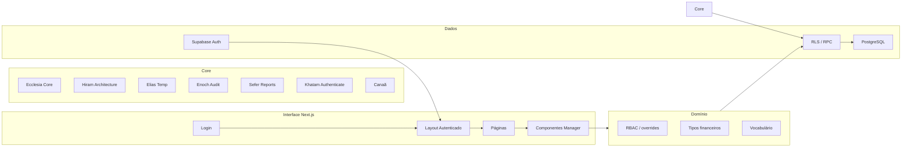
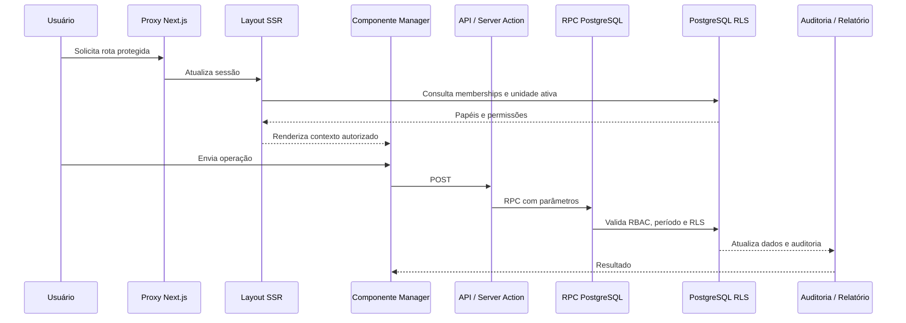

# Visão Geral — Ecclesia Finance ECC 2.0

## Identidade do produto

O ECC 2.0 é um ERP financeiro multi-tenant e hierárquico voltado à gestão financeira de **igrejas** e **ONGs/associações**. A aplicação usa Next.js 16 App Router, React 19, TypeScript, Tailwind CSS e Supabase/PostgreSQL.

A configuração organizacional aceita `church` ou `ong` e altera os termos apresentados pela tela. A implementação está em [[Hiram Architecture]] e [vocabulary.ts](../web/src/domain/vocabulary.ts).

## Monólito Modular

## Componentes reais

| Camada | Conteúdo real |
|---|---|
| Presentação | `src/app`, `src/components` |
| Domínio | `src/domain/access.ts`, `finance.ts`, `vocabulary.ts`, `audit.ts` |
| Aplicação | Server Components, Server Actions e API Routes |
| Integração | `src/lib/supabase`, `src/lib/admin`, `src/lib/reports` |
| Banco | migrations 0001 a 0013 |

## Fluxo de dados

## Autenticação e contexto

- `src/proxy.ts` protege todas as rotas correspondentes ao matcher.
- `/login` e `/api/health` são públicos.
- `src/lib/supabase/middleware.ts` cria o cliente SSR e recupera o usuário.
- `src/app/(authenticated)/layout.tsx` obtém memberships e define a unidade ativa pelo cookie `active_congregation_id`.
- `CongregationSwitcher` permite trocar a unidade ativa.
- O Dev Master é identificado por metadata ou pelo e-mail temporariamente definido como fallback em `isMasterAdmin`.

## Estados reais da implementação

### Implementado no código

- Login e sessão.
- Unidade ativa e troca de unidade.
- Dashboard mensal e hierarquia financeira.
- Entradas, despesas, repasses, caixa, fechamento, ajustes e estornos.
- Auditoria por unidade.
- Relatórios PDF e Excel.
- Administração global de unidades e acessos.
- RLS, RBAC, overrides, idempotência e migrations.
- Licenças básicas Khatam.

### Parcialmente implementado

- Cadastro completo da equipe Canaã.
- Telemetria real Noah Ops.
- Reabertura formal e fluxo de caixa físico na interface.
- Modelo administrativo global depende de `SUPABASE_SERVICE_ROLE_KEY`.
- O convite Canaã depende de licença e configuração server-side.

### Planejado / adiado

- [[Gideon Security]]: Pix mTLS/DICT, defesa de borda, nonce e WORM.
- [[Shofeet Note]]: NF-e/NFC-e/NFS-e, XML, certificado A1 e ITG 2002/SPED.

## Mapa de documentação

- [[Ecclesia Core]]
- [[Hiram Architecture]]
- [[Elias Temp]]
- [[Enoch Audit]]
- [[Sefer Reports]]
- [[Khatam Authenticate]]
- [[Canaa Local]]
- [[Canaa Access]]
- [[Noah Developer]]
- [[Gideon Security]]
- [[Shofeet Note]]
