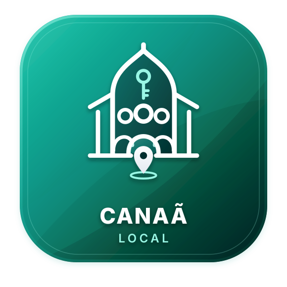

# Canaã Local

| Aspecto | Detalhe |
|---|---|
| Status Real | **Parcialmente implementado** |
| Camada | Core / Unidade |
| Rotas | `/canaa` |
| Tabelas/RPCs | `congregations`, `memberships`, `khatam_licenses` |
| Arquivos principais | `CongregationFlowMap.tsx`, `CongregationNode.tsx`, `canaa.actions.ts` |

## Propósito

Gerenciar a unidade ativa: hierarquia visível, membros da unidade e cotas Khatam.

## Status real

### Implementado
- Página `/canaa`.
- Grafo React Flow com nós e arestas.
- Filtro de unidade ativa e unidades subordinadas disponíveis ao usuário.
- Barra de cotas Khatam.
- Modal de convite local por e-mail.
- Atualização de vínculo pai no módulo de ações.

### Parcial
- `LocalTeamManager` recebe `members=[]` e não carrega membros reais.
- Não há remoção ou edição completa de todos os operadores na interface.
- Dependência de service role para convite e atualização.

## Arquivos

- `src/app/(authenticated)/canaa/page.tsx`
- `src/modules/core/canaa/components/CongregationFlowMap.tsx`
- `src/modules/core/canaa/components/CongregationNode.tsx`
- `src/modules/core/canaa/components/InviteOperatorModal.tsx`
- `src/modules/core/canaa/components/LocalTeamManager.tsx`
- `src/modules/core/canaa/actions/canaa.actions.ts`

## Fluxo interno

1. O usuário precisa estar autenticado.
2. O usuário precisa ser Dev Master ou possuir `hierarchy.view`.
3. A página consulta memberships da unidade.
4. Nós são criados por cada unidade visível.
5. Arestas são criadas quando `parent_id` aponta para uma unidade visível.
6. A licença é carregada para a unidade ativa.
7. Convite usa `inviteOperatorAction`.
