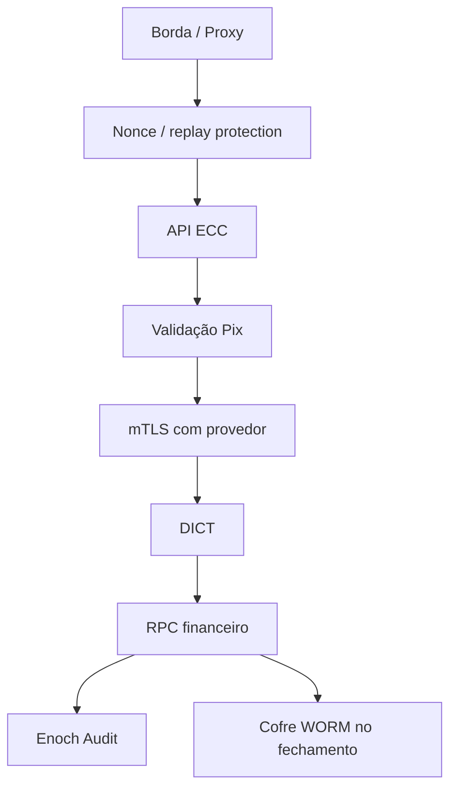

# Gideon Security

| Aspecto | Detalhe |
|---|---|
| Status Real | **Planejado / não integrado** |
| Camada | Plug-in |
| Rotas | Nenhuma |
| Tabelas/RPCs | Nenhuma implementação ativa |
| Arquivos principais | `src/modules/plugins/gideon/README.md` |

## Propósito

Plug-in planejado para defesa em profundidade, proteção da borda, validação bancária Pix e preservação imutável de documentos ou fechamentos.

## Estado

**Planejado / não implementado no código atual.**

Os arquivos existentes são documentação e identidade visual. Não há integração de middleware Pix, certificado mTLS, DICT, nonce ou WORM ativa.

## Arquitetura prevista

## Defesas futuras

- Proteção de borda e validação de origem.
- Anti-replay com nonce e janela temporal.
- Integração Pix por mTLS.
- Consulta DICT para dados de chave/pagador.
- Assinatura ou hash de comprovantes.
- Cofre WORM exclusivo após fechamento.
- Separação de chaves por ambiente.

## Pontos de acoplamento futuros

- [Ecclesia Core](Ecclesia%20Core.md)
- [Elias Temp](Elias%20Temp.md)
- [Enoch Audit](Enoch%20Audit.md)
- [Noah Ops](Noah%20Ops.md)
