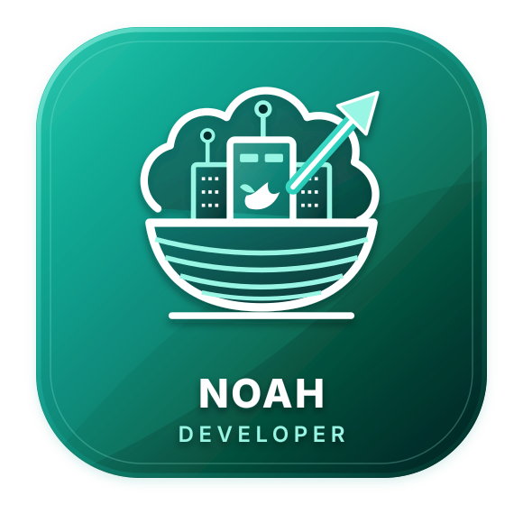

# Noah Developer / Noah Ops

| Aspecto | Detalhe |
|---|---|
| Status Real | **Parcialmente implementado** |
| Camada | Core / Observabilidade |
| Rotas | `/noah-ops` |
| Tabelas/RPCs | Nenhuma consulta de telemetria real |
| Arquivos principais | página `/noah-ops`, `NoahTelemetryGrid.tsx`, `ModuleArchitectureMap.tsx` |

## Propósito

Console técnica exclusiva do Dev Master para governança da plataforma e monitoramento dos módulos.

## Status real

### Implementado no código
- Rota `/noah-ops`.
- Autorização via `isMasterAdmin`.
- Componente `NoahTelemetryGrid`.
- Lista estática de módulos com saúde `unknown`.
- Identidade visual da marca Noah.

### Parcial
- Não há coleta real de métricas.
- Não há consulta de latência, saúde, filas ou disponibilidade.
- `CongregationFlowMap` é renderizado vazio.
- Plugins Gideon e Shofeet aparecem como “Em breve”.

## Arquivos

- `src/app/(authenticated)/noah-ops/page.tsx`
- `src/modules/core/canaa/components/NoahTelemetryGrid.tsx`
- `src/modules/core/canaa/types.ts`
- `src/domain/access.ts`

## Telemetria atual

Os módulos Khatam, Hiram, Elias, Enoch e Sefer são exibidos com `health: "unknown"`. Isso não representa um health check real.

## Próximas integrações

Uma implementação futura deve:
- consultar `/api/health`;
- verificar Supabase e migrations;
- consultar indicadores de jobs e filas;
- registrar latência e erros;
- separar telemetria técnica de dados financeiros;
- evitar exposição de secrets ou dados pessoais.
