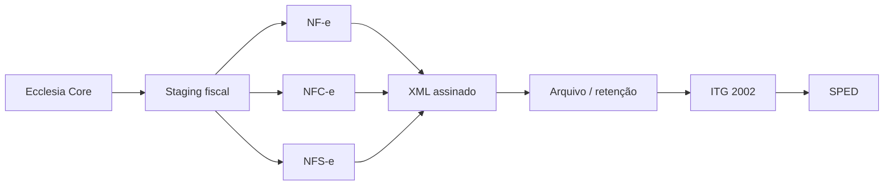

# Shofeet Note

| Aspecto | Detalhe |
|---|---|
| Status Real | **Planejado / adiado** |
| Camada | Plug-in fiscal |
| Rotas | Nenhuma |
| Tabelas/RPCs | Nenhuma implementação ativa |
| Arquivos principais | `src/modules/plugins/shofeet/README.md` |

## Propósito

Plug-in fiscal planejado para integrar notas fiscais, XML, certificados A1 e padrões contábeis sem acoplar essas regras ao núcleo financeiro.

## Estado

**Planejado / adiado no roadmap atual.**

Não há emissão fiscal, certificado, storage fiscal ou integração contábil implementada no código.

## Arquitetura futura

## Capacidades futuras

- NF-e, NFC-e e NFS-e.
- Upload e validação de XML.
- Certificado A1 protegido por cofre.
- Controle de imunidade tributária e natureza da operação.
- Plano de contas compatível com ITG 2002.
- Exportações e validações SPED.
- Associações entre documento fiscal e lançamento financeiro.

## Acoplamentos futuros

- [[Ecclesia Core]]
- [[Enoch Audit]]
- [[Sefer Reports]]
- [[Gideon Security]]
